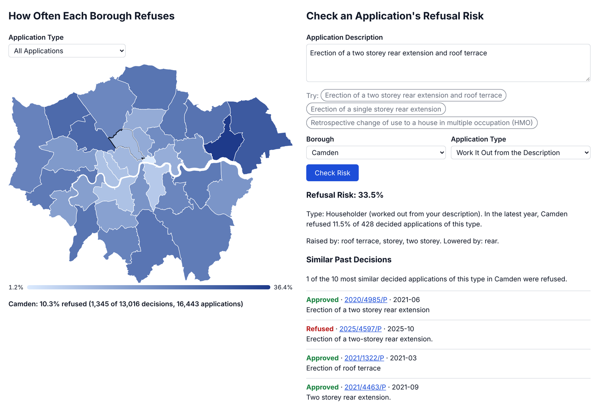
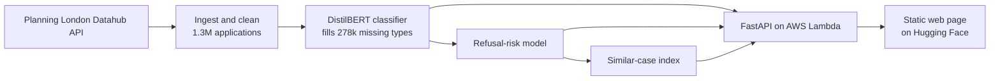

# PlanScope London

[](https://github.com/samaddmirzaa/london-planscope/actions/workflows/ci.yml)

**Machine Learning over 1.3 million London Planning Applications: What Type an Application is, How Likely it is to be Refused, and Which Past Decisions it most resembles.**

**[Try the live demo](https://huggingface.co/spaces/samaddmirzaa/planscope-london)** · [API docs](https://ffchzj1mwk.execute-api.eu-west-2.amazonaws.com/docs)



Type a planning application description, as a council would write it, and choose a borough:

- **Refusal Risk:** The chance it is refused if decided, with the words that raised or lowered it and the borough's recent average for that type.
- **Similar Past Decisions:** The 10 most alike decided applications in that borough, each with its outcome and a link to the council's record.
- **Application Type:** A fine-tuned transformer works out which of 9 legal routes (householder, full planning, tree works…) it was filed under.
- **Borough Map:** How often each London borough refuses, by application type.

## Results

| Task | Approach | Result | Compared with |
|---|---|---|---|
| Classify the application type (9 classes) | Fine-tuned DistilBERT, int8 ONNX on CPU | **macro-F1 0.888** | TF-IDF + logistic regression 0.866; Amazon Nova LLMs 0.68–0.76 |
| Predict refusal | TF-IDF text + borough × type, calibrated logistic regression | **ROC-AUC 0.76, PR-AUC 0.41** | Borough × type average 0.69 / 0.31; no skill 0.50 / 0.16 |
| Find similar past decisions | TF-IDF cosine similarity within borough and type | **ROC-AUC 0.72** for the neighbours' refusal share | Sentence embeddings (MiniLM, BGE), borough only: 0.70–0.72, and they confuse direction |

- **Macro-F1** Averages the score over all 9 types, so rare types count as much as common ones.
- **ROC-AUC 0.76:** Shown one refused and one approved application, the model gives the refused one the higher risk 76% of the time.
- **PR-AUC:** How well it finds refusals. Guessing scores 0.16, the share of applications refused.
- **In practice:** The riskiest 10% of test applications were refused 47% of the time, against 16% overall.

- **A Small Fine-Tuned Model Beat the LLMs.** On the same 900 test descriptions, DistilBERT (0.888) beat Amazon Nova Micro, Lite and Pro (0.68–0.76). It's also faster (5 ms per description on a laptop CPU) and free to run. The LLMs missed legal conventions learned from 400k labelled examples, such as when a house extension is filed as full planning rather than householder. Two examples per type lifted Nova Lite to Nova Pro's level at a sixth of the cost.
- **Leakage Removed.** Some councils add text after an application is submitted: appeal references that only exist after a refusal, and "amended plans" notes added during negotiation. Both are stripped, so the model only sees what an applicant would write.
- **Split by Date, not at Random.** Refusal rates fell from 18–21% (2019–2023) to 16% (2025). The model trains on earlier years, is tested on a later one, and is recalibrated on the most recent decided year.
- **Simpler Won Twice.**
  - Logistic regression matched LightGBM (ROC-AUC 0.76 for both) with better PR-AUC, and it explains each prediction word by word.
  - For similar-case search, word-based TF-IDF beat sentence embeddings. The embeddings treated "convert a house into flats" and "convert flats into a house" as the same, and TF-IDF's word pairs get the direction right.
- **Form fields left out.** Units and storeys sounded useful but made the model worse: their coverage fell from 89% to 56% of applications over time.

## Architecture



- **API:** a Docker container on AWS Lambda (London region) behind API Gateway. It scales to zero, so the whole system costs under $1 a month.
- **Serving needs No ML Frameworks:** The classifier runs on ONNX Runtime, and the risk model and search are re-implemented in numpy. A test checks the risk model matches scikit-learn to 1e-5.

## Tech stack

- **ML:** PyTorch, Hugging Face Transformers, scikit-learn, ONNX Runtime (int8 quantisation), Amazon Bedrock (Nova).
- **Data:** pandas, Parquet, the Datahub's Elasticsearch API.
- **Serving:** FastAPI, Docker, AWS Lambda, API Gateway, S3, ECR, AWS SAM (CloudFormation).
- **Engineering:** GitHub Actions CI/CD, OIDC, pytest, ruff.
- **Front end:** a plain HTML/JavaScript page with an SVG map, on Hugging Face Spaces.

## How it was Built

Each notebook ends with a findings cell recording what was tested and why each choice was made.

| Notebook | What it covers |
|---|---|
| [01 Data profiling](notebooks/01_data_profiling.ipynb) | Data quality, coverage by borough and year, cleaning rules |
| [02 Category classifier](notebooks/02_category_classifier.ipynb) | TF-IDF baseline, DistilBERT fine-tuning, ONNX export |
| [03 Outcome model](notebooks/03_outcome_model.ipynb) | Leakage audit, baselines, calibration, error analysis |
| [04 LLM benchmark](notebooks/04_llm_benchmark.ipynb) | Amazon Nova vs the fine-tuned model: accuracy, cost, speed |
| [05 Similar applications](notebooks/05_similar_applications.ipynb) | TF-IDF vs sentence embeddings for retrieval |

```
src/planscope/   pipeline and API code (ingest, clean, train, export, serve)
tests/           unit tests, incl. a check that the served risk model matches scikit-learn
space/           the web page
template.yaml    the API's AWS infrastructure (SAM)
bootstrap.yaml   GitHub-to-AWS deploy permissions
```

## Run it locally

Requires Python 3.11.

```bash
pip install -e ".[dev,serve]"
python -m planscope.ingest          # download the applications (about 1.3M records)
python -m planscope.clean
python -m planscope.category_data
# fine-tune DistilBERT in notebooks/02 (GPU; needs pip install -e ".[train]"), then:
python -m planscope.export_onnx
python -m planscope.fill_categories
python -m planscope.outcome_data
python -m planscope.outcome_model
python -m planscope.similar
python -m planscope.map_data        # the map's borough data
uvicorn planscope.api:app --reload  # then open http://localhost:8000/docs
```

## Data and limitations

- **Data:** [Planning London Datahub](https://www.london.gov.uk/programmes-strategies/planning/digital-planning/planning-london-datahub), Greater London Authority, used with permission. The data and trained models are not in this repository; the scripts above rebuild them.
- **What the risk model can't see:** it reads only the description, borough and type, not drawings, objections or planning policy. It's a guide, not a verdict.
- **Limited by the data itself:** identical descriptions are sometimes filed under different types, which caps text-only classification at about 91% accuracy. Councils don't publish refusal reasons in this dataset.
- **Drift:** refusal rates change over time, so the risk model should be recalibrated as new decisions arrive.
